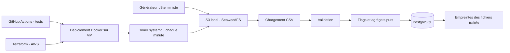

# Transaction Pipeline

Projet d'intégration et de déploiement continus : génération déterministe de transactions financières, validation CSV, traitements purs, stockage S3 et insertion atomique en base relationnelle.

Les **niveaux 1 et 2** sont implémentés. Le **niveau 3** utilise les options **1 (CD sur VM Docker avec planification)** et **4 (infrastructure AWS avec Terraform)**. Le [sujet original](sujet.md) est conservé.



## Démarrage rapide

Prérequis : Python 3.12 ou supérieur, `make`, Docker Engine et Docker Compose v2. Les commandes suivantes s'exécutent à la racine de **ce dossier**.

```bash
make install
cp .env.example .env
make run
make report
make integration
```

`make run` démarre PostgreSQL et SeaweedFS, construit l'image Python, crée le bucket, génère **deux CSV de six transactions**, les envoie et vérifie leur contenu dans S3, puis lit **exclusivement S3** pour les traiter. Aucun CSV local n'est nécessaire dans ce mode. Les versions des dépendances sont fixées dans les fichiers `requirements*.lock`.

Résultat attendu : **2 fichiers, 12 transactions, 4 flags**, montant total **33 000,64 €**. Le rapport affiche les montants **en centimes**, sans perte liée aux nombres flottants. Un deuxième `make run` affiche `inserted: 0`, `skipped: 2`, toujours 12 transactions.

Les services n'exposent que `127.0.0.1:5433` (PostgreSQL) et `127.0.0.1:8333` (S3). Modifier `POSTGRES_PORT` ou `S3_PORT` dans `.env` si ces ports sont occupés. Les mots de passe de démonstration sont publics ; ceux de la VM sont générés automatiquement. Utiliser des valeurs alphanumériques ou hexadécimales pour les secrets Compose (insertion dans une URL et un fichier JSON).

### Mode local, sans Docker

```bash
make install
make local
make test
make lint
```

Les CSV sont créés dans `data/input/` et la base SQLite dans `data/pipeline.db`. Ces fichiers sont ignorés par Git.

### Commandes utiles

| Commande | Effet |
|---|---|
| `make run` | Générer, uploader, traiter via S3 et PostgreSQL |
| `make process` | Traiter les nouveaux CSV déjà présents dans S3 |
| `make report` | Lire les compteurs et agrégats de PostgreSQL |
| `make test` | Tests unitaires et intégration SQLite, avec couverture |
| `make integration` | Tests sur les vrais services S3/PostgreSQL, isolés dans des schémas et buckets temporaires |
| `make demo` | Échec CSV, correction, déduplication et retries SQL |
| `make down` | Arrêter les services en conservant les données |

`docker compose down -v` supprime définitivement les volumes et les données de cette stack. À utiliser uniquement pour repartir de zéro.

## Traitements et validation

- Sommes par IBAN émetteur, banque émettrice et IBAN destinataire.
- Flag lorsque le montant est **strictement supérieur à 5 000 €** : 5 000,00 € n'est pas signalé, 5 000,01 € l'est.
- Objets immuables et fonctions pures dans `domain.py` ; chargement séparé dans `csv_io.py`.
- Colonnes exactes, UTF-8, champs obligatoires, date ISO 8601 avec fuseau, montant positif fini avec au plus deux décimales.
- Validation de la longueur et du checksum modulo 97 des IBAN, cohérence pays/IBAN. Pays pris en charge : FR, DE, GB, ES, IT, BE et NL.
- Données entièrement synthétiques, répétables et en euros ; aucun taux de change.

Les fichiers de génération utilisent des IBAN de démonstration. Totaux de référence :

| Regroupement | Clé | Montant en euros |
|---|---|---:|
| Émetteur / banque | FR / Banque Alpha | 10 600,60 |
| Émetteur / banque | DE / Banque Beta | 10 000,04 |
| Émetteur / banque | GB / Banque Gamma | 12 400,00 |
| Destinataire | DE | 600,60 |
| Destinataire | FR | 22 400,02 |
| Destinataire | GB | 10 000,02 |

## Fiabilité

L'identité d'un fichier est le **SHA-256 de ses octets**. Renommer ou réuploader le même contenu ne réinsère rien. La base enregistre l'empreinte, les transactions et les agrégats **dans la même transaction SQL**. Un échec annule toutes les écritures du fichier ; un conflit concurrent sur l'empreinte n'insère aucune ligne. L'insertion utilise `ON CONFLICT DO NOTHING RETURNING` sur PostgreSQL et SQLite.

Les retries sont bornés (4 tentatives par défaut) avec attentes exponentielles (1, 2, 4 secondes). Les erreurs de validation et les refus d'accès S3 échouent immédiatement. Les pannes réseau/S3 temporaires et les erreurs SQL transitoires identifiées sont réessayées. Après épuisement : log explicite et code de sortie 1.

```bash
# Sur une base neuve, deux pannes SQL ET deux pannes de récupération S3, puis succès.
docker compose run --rm pipeline run --source s3 --fail-db 2 --fail-s3 2

# Échec après trois tentatives de récupération, même si les fichiers sont déjà traités.
docker compose run --rm pipeline process --source s3 --fail-s3 3 --attempts 3
```

La panne SQL simulée se produit **après l'écriture des transactions, avant le commit**, pour tester le rollback. Elle ne se déclenche pas pour un fichier déjà traité. `make demo` utilise des bases temporaires neuves pour rendre ce scénario toujours reproductible.

## Organisation

```text
src/transaction_pipeline/   modèles, validation, génération, SQL, S3, orchestration, CLI
 tests/                    tests purs, SQLite, CLI, S3 et PostgreSQL
 scripts/                  démonstration, captures et lancement des tests de services
 .github/workflows/ci.yml   qualité, intégration réelle, validation Terraform, CD
 deploy/                   déploiement VM et timer systemd
 infra/                    VPC, sous-réseau, accès SSH, EC2, disque et IP fixe AWS
 docs/                     architecture, démonstration et déploiement
```

Voir [les vérifications réalisées](docs/verification.md), [l'architecture et les limites](docs/architecture.md), [les preuves d'échec et de correction](docs/demonstration.md), et [le guide de déploiement](docs/deploiement.md).

## CI/CD sur GitHub

Le projet est publié dans [Tristan-Bourhis/Projet_integration_et_deploiement_continus](https://github.com/Tristan-Bourhis/Projet_integration_et_deploiement_continus).
Les exécutions sont disponibles dans [GitHub Actions](https://github.com/Tristan-Bourhis/Projet_integration_et_deploiement_continus/actions).
La branche `demo/echec-ci` conserve une régression volontaire du seuil de signalement suivie de sa correction ; voir [les preuves](docs/demonstration.md).

La CI s'exécute automatiquement à chaque push et pull request : Ruff, tests Python 3.12/3.14, vrais services S3/PostgreSQL, image Docker, déduplication, `terraform fmt` et `terraform validate`. Les journaux et rapports sont conservés comme artifacts GitHub Actions. Les scénarios d'échec attendus de `make demo` sont vérifiés et ne font pas échouer la CI ; une régression inattendue la fait échouer.

Le job CD n'est activé qu'après configuration de la VM, des secrets GitHub et de `DEPLOY_ENABLED=true`. Les instructions sont dans [docs/deploiement.md](docs/deploiement.md). Aucune ressource cloud n'est créée simplement en poussant le dépôt.
