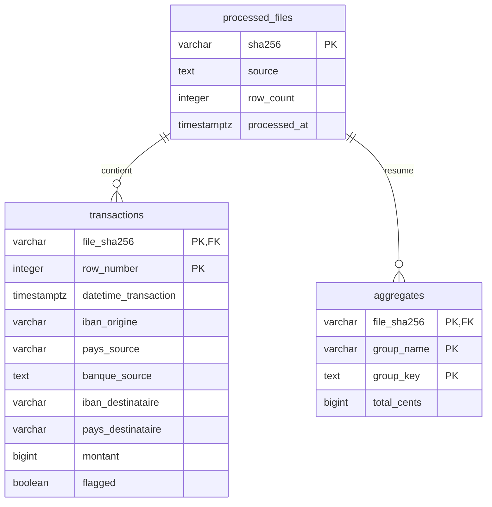

# Architecture et choix techniques

## Modèle relationnel

Les agrégats sont calculés par les fonctions Python pures puis enregistrés **par fichier**. Le rapport les additionne pour produire les sommes globales. Cela évite les mises à jour concurrentes de compteurs globaux. Le champ `transactions.montant` est un entier en centimes ; les agrégats utilisent également des entiers.

L'empreinte est vérifiée avant validation/traitement pour les fichiers connus ; la contrainte de clé primaire constitue la seconde protection indispensable contre deux workers concurrents. `RETURNING` permet de savoir si ce worker a effectivement réservé l'empreinte, sans dépendre du `rowcount` propre au pilote. En cas d'échec ou de résultat de commit ambigu, une nouvelle tentative retrouve soit aucune empreinte (rollback), soit l'empreinte déjà validée (aucune réinsertion).

## Périmètre et limites explicites

- Atomicité **par fichier**, pas par bucket : les fichiers déjà validés restent en base si un fichier suivant est invalide. Celui-ci fait échouer la commande et n'est pas marqué traité.
- Un contenu différent sous le même nom est un **nouveau fichier**. Ce projet empêche le double traitement de fichiers identiques ; il n'effectue pas de déduplication métier entre transactions de fichiers différents, faute d'identifiant transactionnel dans le sujet.
- Les fichiers S3 sont téléchargés pour calculer leur empreinte, même s'ils ont déjà été traités ; validation et calculs sont ensuite évités. Les ETag ne sont pas utilisés comme hashes de contenu.
- Lecture CSV en mémoire, parcours paginé du bucket et traitement séquentiel ; adapté au volume pédagogique, à faire évoluer en streaming pour de gros fichiers.
- SQLite sert au mode local. PostgreSQL est utilisé dans Docker, la CI de services et la VM.
- `create_all` initialise le schéma. Une évolution réelle du schéma nécessiterait des migrations versionnées.
- PostgreSQL et SeaweedFS sur une seule VM et des volumes Docker : pas de haute disponibilité ni de sauvegarde distante automatique. Le disque est chiffré par Terraform, mais une destruction de la VM peut supprimer les données ; prévoir des sauvegardes avant utilisation durable.
- Le timer lit les nouvelles données ; il ne fabrique pas de faux nouveaux fichiers de démonstration à chaque minute.

## Références techniques

- [SQLAlchemy : SQLite et ON CONFLICT](https://docs.sqlalchemy.org/en/20/dialects/sqlite.html#insert-on-conflict-upsert)
- [SeaweedFS : exemple officiel d'identités S3](https://github.com/seaweedfs/seaweedfs/blob/master/docker/compose/s3.json)
- [Provider Terraform AWS](https://registry.terraform.io/providers/hashicorp/aws/latest/docs)
