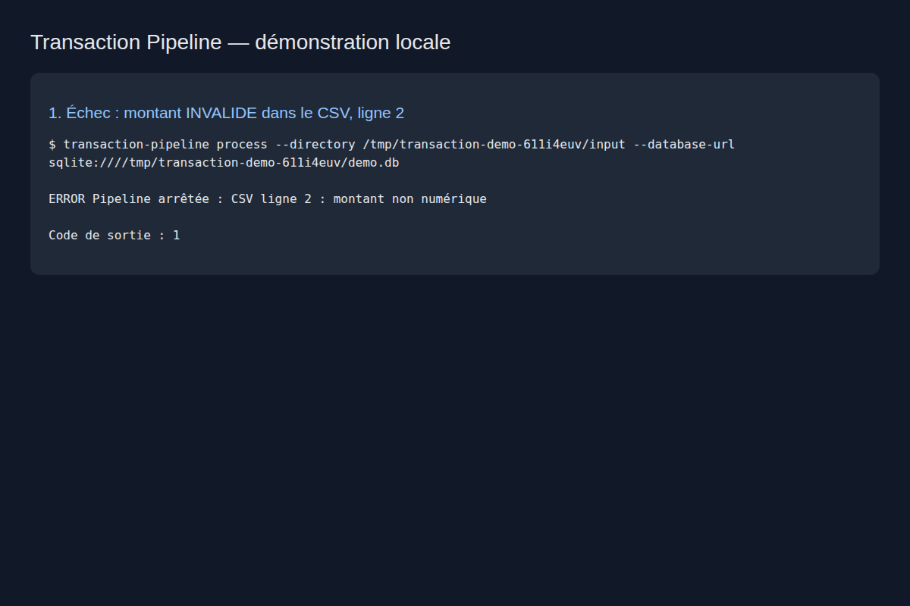
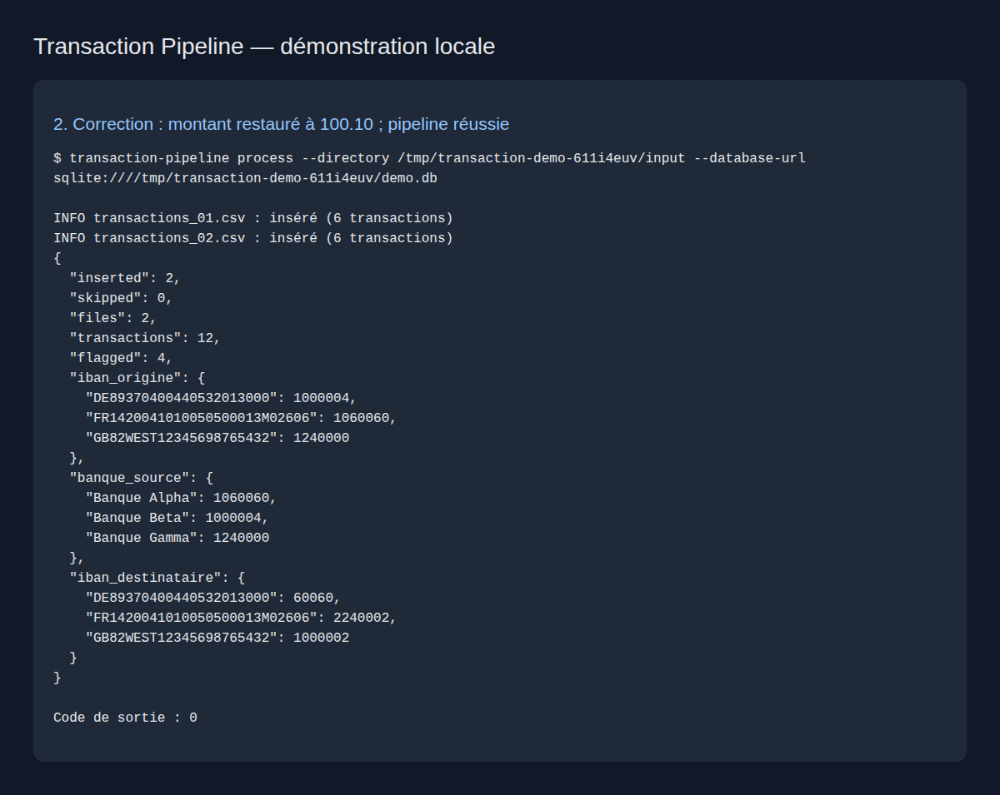
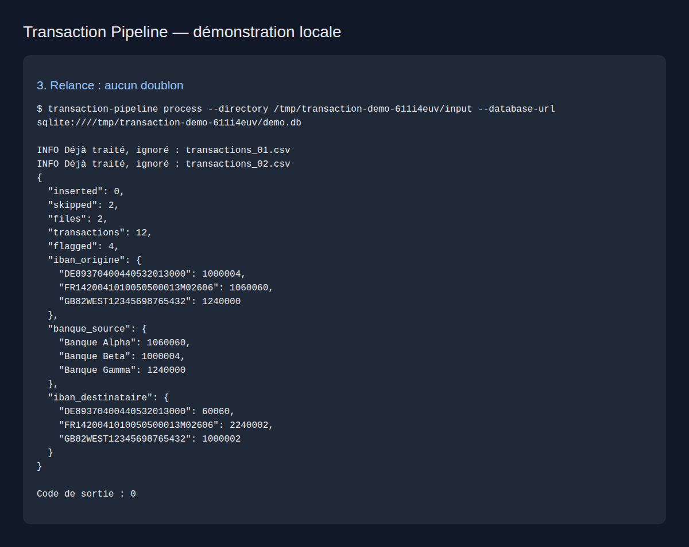
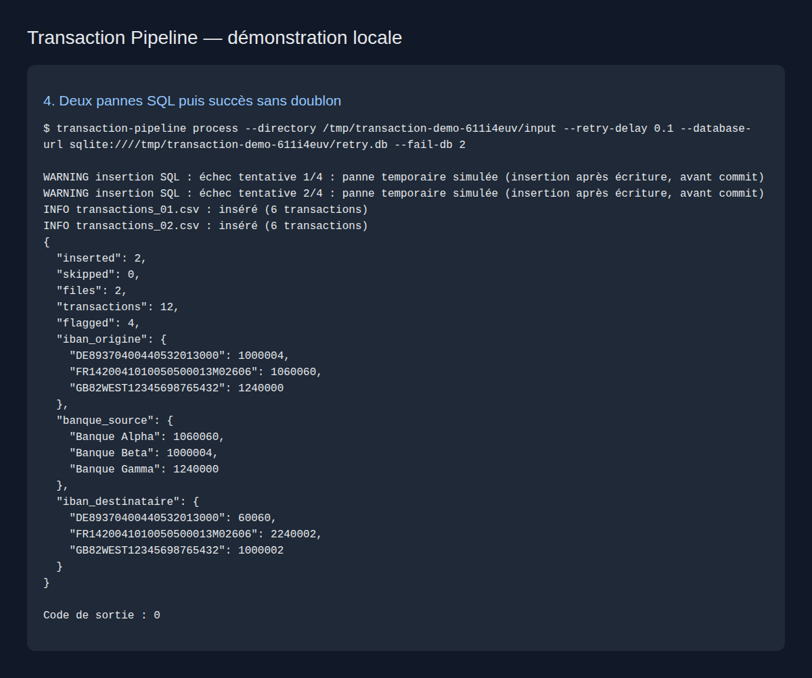
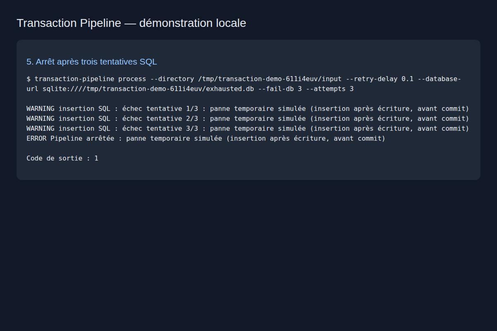
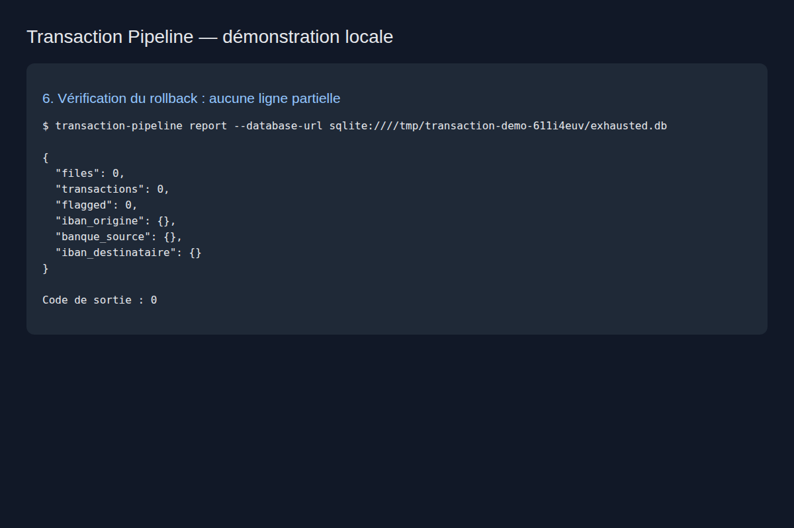
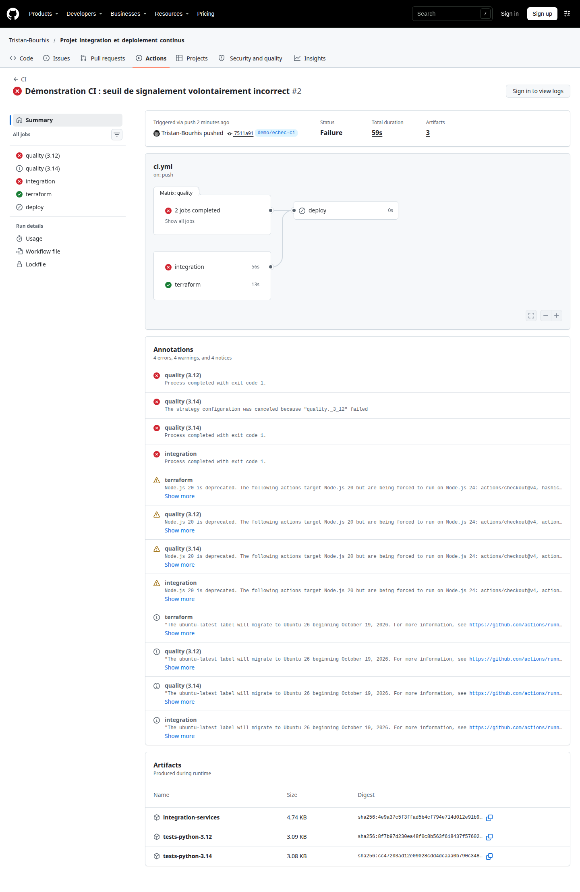
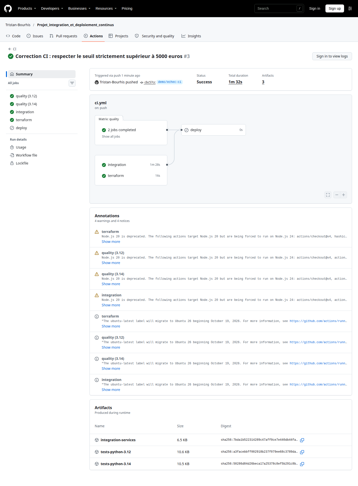
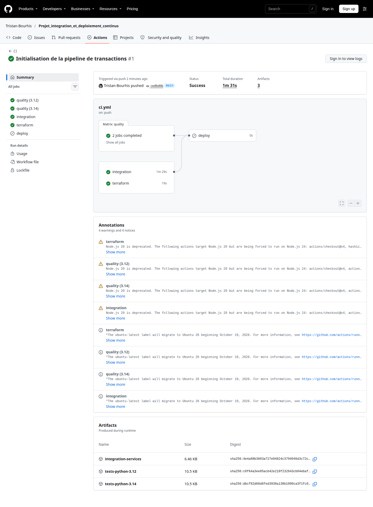

# Échec, correction et retries

La démonstration est exécutée par `make demo`. Elle lance réellement la CLI dans des processus séparés, vérifie leurs codes de sortie et conserve stdout/stderr dans `artifacts/demo/`. Les captures ci-dessous montrent ces sorties locales affichées dans Chromium ; elles ne prétendent pas montrer une exécution sur GitHub Actions.

## 1. Cause et échec

Le script remplace le montant `100.10` par `INVALIDE` à la ligne 2 du premier CSV. La validation échoue avant toute insertion. Le processus renvoie **1** et indique `CSV ligne 2 : montant non numérique`.



## 2. Correction et réussite

Le montant est restauré à `100.10`. La même commande réussit : **2 fichiers, 12 transactions, 4 flags**, code de sortie **0**.



## 3. Relance sans doublons

Le même dossier est traité à nouveau. Les empreintes existent déjà : **0 insertion, 2 fichiers ignorés**, toujours 12 transactions.



## 4. Retry SQL avec rollback

Deux pannes sont injectées après insertion des transactions et avant le commit. Chaque échec annule la réservation de l'empreinte et les écritures partielles. La troisième tentative réussit, sans doublon.



## 5. Épuisement des tentatives et absence d'écriture partielle

Trois pannes pour trois tentatives autorisées : la pipeline s'arrête avec le code **1**. Un rapport indépendant confirme que la base contient **0 fichier et 0 transaction**.





## Reproduire les captures

```bash
make demo
# Facultatif, uniquement pour régénérer les PNG :
.venv/bin/pip install playwright==1.63.0
.venv/bin/playwright install chromium
.venv/bin/python scripts/screenshots.py
```

`artifacts/demo/rapport.html` permet aussi de consulter tous les journaux dans un navigateur. Le script de captures ne fabrique pas les messages : il capture les HTML produits à partir des vrais résultats de la CLI.

## Retry S3

`make integration` déclenche deux échecs de récupération puis vérifie le succès et les valeurs en PostgreSQL. Un autre test impose cinq échecs pour cinq tentatives et vérifie qu'aucune transaction n'a été insérée. Les tests unitaires couvrent également un vrai objet d'erreur HTTP 503, un échec de connexion, la pagination et l'absence de retry sur HTTP 403.

La CI exécute aussi le conteneur complet avec `--fail-db 2 --fail-s3 2`. Une démonstration sur GitHub Actions est également disponible ci-dessous.

## Démonstration réelle sur GitHub Actions

Le 9 novembre 2026, la branche `demo/echec-ci` a été utilisée pour publier une erreur volontaire, puis sa correction, sans modifier le code de `main`.

1. **Cause** : le commit `7511a91` remplace `montant > 500_000` par `montant >= 500_000` dans `domain.py` (montants en centimes). Les transactions de exactement 5 000 € sont alors signalées à tort.
2. **Échec** : [exécution 42585545054](https://github.com/Tristan-Bourhis/Projet_integration_et_deploiement_continus/actions/runs/42585545054). Les tests unitaires et d'intégration échouent. Le test CLI indique `assert 6 == 4` ; le test de pureté et de seuil constate également le flag incorrect.
3. **Correction** : le commit `cbc57cc` restaure l'opérateur strict `>`.
4. **Réussite après correction** : [exécution 42585585329](https://github.com/Tristan-Bourhis/Projet_integration_et_deploiement_continus/actions/runs/42585585329).

Ces liens pointent vers les exécutions distantes réelles. Les six premières captures de ce document restent celles de la démonstration locale.






